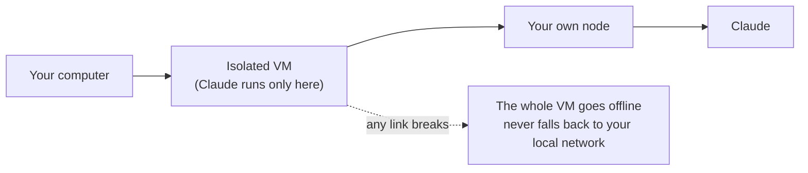

# cchouse

**A clean, stable, leak-proof environment dedicated to Claude.**
cchouse runs a small isolated virtual machine on your computer. You use Claude on the web and Claude Code inside it, and all its traffic goes through your own proxy node. If the node drops, the whole VM goes offline instead of quietly falling back to your local network.

[](https://github.com/nana-fox/cchouse/actions/workflows/ci.yml)
[](https://github.com/nana-fox/cchouse/releases)
[](LICENSE)

[中文](README.md) | English


---

## Who it's for

You already have your own proxy node and want to use Claude (web + Claude Code) day to day without worrying about:

1. **A drifting IP**: one region today, another tomorrow.
2. **A mismatched environment**: a US IP on a machine set to another time zone and language.
3. **Silent fallback**: the proxy drops for a few seconds, apps switch to your local network, and your real IP leaks.

cchouse pins one exit, matches time zone, language and region to it, and stays offline when the exit is down.

---

## How it works



The VM can only reach your one node. Your computer keeps using the internet as usual.

---

## Quick start

> This is the target flow. The one-command installer (`cchouse.py up`) is still in development; until it is released, follow the [manual install](docs/manual-install.md) (Chinese).

1. **Install the VM software** (one-time)
   - Apple Silicon Mac: `brew install cirruslabs/cli/tart`
   - Windows / Intel Mac: free VMware Workstation Pro / Fusion Pro (requires a Broadcom account to download).
2. **Run one command and paste your node link** (about 3 minutes in our tests, plus the first image download)
   ```bash
   git clone https://github.com/nana-fox/cchouse.git && cd cchouse
   python3 scripts/cchouse.py up
   ```
3. **Open the VM desktop, wait for all green, then sign in** using the browser inside the VM. Open the Claude Code sign-in link only in the VM's browser, never on your host.

---

## Supported computers

| Your computer | VM software | Status |
|---|---|---|
| Apple Silicon Mac | Tart | ✅ Verified on real hardware (2026-11-25, Mac mini) |
| Windows (x64) | VMware Workstation Pro | ✅ Verified on real hardware (2026-11-25) |
| Intel Mac | VMware Fusion Pro | 🟡 Supported, same image as Windows, not yet verified separately |

The guest is always Debian 13 + Chromium + Claude Code. Linux hosts are not supported.

On 2026-11-25, two real machines ran the one-command check: Mac mini (Tart) in 2m35s and Windows (VMware) in 2m55s, with all 26 automated checks passing.

---

## What you need

- **One proxy node** (cchouse doesn't provide one): SOCKS5, HTTP(S), VLESS, Trojan or Shadowsocks. UDP-based protocols such as Hysteria2, TUIC and WireGuard are not supported.
- **16 GB+ RAM and 25 GB+ free disk** recommended.

> **Stripe**: some nodes block Stripe. That only affects paying on claude.ai. Installation warns you but doesn't stop. See [docs/proxy-modes.md](docs/proxy-modes.md) for an optional payment-only node and the advanced two-hop chain mode.

---

## FAQ

- **Will my account get banned?** No guarantee. We pin one exit, keep the environment consistent with it, block leaks, and use only the official web app and Claude Code. We don't provide nodes, spoof fingerprints, or sign up, sign in or pay for you.
- **Why a VM instead of a fingerprint browser or a plain proxy?** A plain proxy often falls back to direct traffic and CLI tools may ignore it. A fingerprint browser doesn't cover Claude Code. A VM locks the network for the whole system, so web and CLI share one exit.
- **Stripe is blocked.** Only paying on claude.ai is affected. Add a payment-only node if you need it.
- **Downloads are slow.** Download the image on your host first, then import it offline following the manual install.
- **Something failed.** Run `python3 scripts/doctor.py --env <path to instance.env> --vm-ssh` to export a redacted diagnostic zip and attach it to an [issue](https://github.com/nana-fox/cchouse/issues).
- **Why a Broadcom account for VMware?** VMware is free for personal use, but Broadcom requires an account to download it. We're looking at alternatives that don't need one. Tart doesn't need an account.

---

## Security design

One account, one VM, one exit. Default-deny firewall that only lets the proxy reach your node, with no direct rules and with UDP and IPv6 blocked, so any failure means offline. Time zone, language and region match the exit and are checked automatically. Everything, including the sign-in link, stays inside the VM. Credentials stay in a private local directory and never enter the repo.

We will **never** bundle proxy nodes, relax the offline protection, or ship a desktop GUI app. Details: [docs/architecture.md](docs/architecture.md).

---

## Disclaimer

cchouse is a local environment setup tool. It **does not guarantee account safety** and provides no proxy service. You are responsible for following local laws and the terms of service of Anthropic and any service you use.

## License · Contributing · Changelog

[MIT](LICENSE) · Issues and PRs welcome (see [AGENTS.md](AGENTS.md)) · [CHANGELOG.md](CHANGELOG.md)
