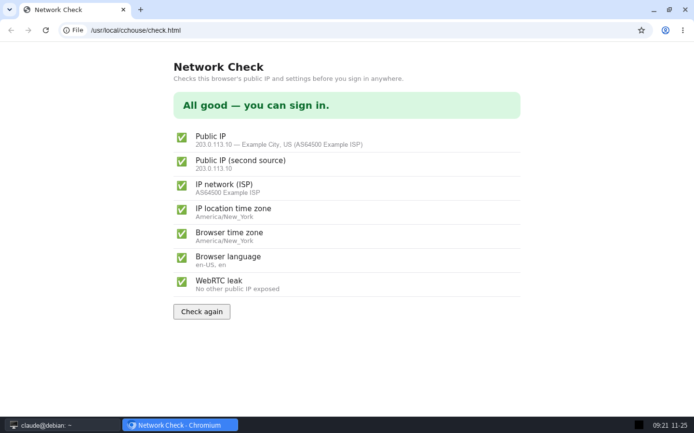
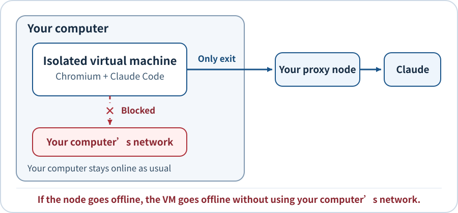

# cchouse

**A clean, stable, leak-proof environment dedicated to Claude.**
cchouse runs a small isolated virtual machine on your computer. You use Claude on the web and Claude Code inside it, and all of its traffic goes only through your own proxy node. If that node drops, the whole machine goes offline. It will not quietly fall back to your computer's own network.

[](https://github.com/nana-fox/cchouse/actions/workflows/ci.yml)
[](https://github.com/nana-fox/cchouse/releases)
[](LICENSE)

[中文](README.md) | English



---

## Who it's for

You already have your own proxy node and want to use Claude (the website and Claude Code) steadily, without worrying about:

1. **A drifting IP**: one region today, another tomorrow.
2. **An environment that does not match**: the IP is in the United States, but the computer's time zone is Beijing and the system language is Chinese.
3. **A proxy that fails open**: for the few seconds the node is down, software quietly uses your computer's own network and your real IP leaks.

cchouse uses only the one node you configure, sets the VM's time zone, language, and region to match where that node is, and stays offline when the node is down. It does not switch to another path on its own.

---

## How it works



- Inside the VM, only traffic to your one node is allowed. Every other path is blocked.
- Your computer itself keeps using the internet as usual.

---

## Quick start

The quick start runs the current installer from `main` and uses the `v2.0.0-preview.2` image. The installer downloads the file from the in-repo image manifest and checks it. [Image size and SHA-256](guest-linux/image-manifest.json)

**Step 1: Install the base tools** (one time)

- On an **Apple Silicon Mac**, install [Homebrew](https://brew.sh), Git, and Python 3, then run `brew install cirruslabs/cli/tart`.
- On **Windows (x64)**, install [Git for Windows](https://git-scm.com/download/win), Python 3 (run it as `py -3` in PowerShell), and the OpenSSH client (Windows Settings → Optional features). Confirm that CPU virtualization is enabled in the BIOS. You do not install VirtualBox yourself.

**Step 2: Run this one command and paste a node link**

```bash
git clone https://github.com/nana-fox/cchouse.git && cd cchouse && python3 -I scripts/cchouse.py up
```

In Windows PowerShell, replace `python3` in that command with `py -3`.

When prompted, paste only the node link. The input is not shown. That is the only thing you type during install. The installer detects the exit time zone and the expected exit IP, prints them, and uses those values. After that, no further action is needed; wait for the automated verification to finish. The installer downloads and checks the image and the official Claude Code package in the background over the host network, and at the same time finishes configuration and its own checks. Apple Silicon Mac uses Tart. Windows uses VirtualBox. On both, it creates the guest (importing the image or cloning an existing golden image), injects the configuration offline, deletes the plaintext config files, reboots onto the network, runs `verify-linux.sh --fail-closed`, and saves a clean snapshot after that passes. [Manual install](docs/manual-install.md)

If installation fails, it stops on the step that failed. Fix the cause it prints, then rerun this same command from the same directory. The installer resumes from the saved steps and the downloads it has already checked.

**Step 3: Open the VM desktop, and sign in only after every network check passes**

On a Mac, after verification passes, the installer opens the guest window. In the guest's Chromium, look at the Network Check page (the picture above). On Windows, the installer does not open a window. Open claude-cc01 in VirtualBox, and look at the same page in the guest's Chromium. After every network check passes, sign in to Claude in **the browser inside the VM**. That page checks the network only. It does not say anything about the account.

> The authorization link shown when you sign in to Claude Code must also be opened in the browser inside the VM. Do not copy it into the browser on your own computer.

To run each step yourself, or to have an AI agent install it for you, see [docs/manual-install.md](docs/manual-install.md).

---

## Supported computers

| Your computer | VM software | Status |
|---|---|---|
| Apple Silicon Mac (M series) | Tart | ✅ Public `v2.0.0-preview.2` cold install finished on a Mac mini |
| Windows (x64) | VirtualBox | ✅ `preview.2` passed real-machine import and desktop verification |
| Intel Mac | — | Not supported for now |

The guest is always Debian 13 + Chromium + Claude Code. A Linux computer is not supported as the host.

**First install with an empty cache** (includes the image and Claude Code downloads)

- **Apple Silicon Mac**: a public `v2.0.0-preview.2` empty-cache install on a Mac mini took **2 minutes 15 seconds**, covering the download, automated verification, and saving a clean snapshot. The download went through the host proxy. The image averaged 20.67 MiB/s, and Claude Code averaged 16.31 MiB/s.
- **Windows (VirtualBox)**: the image is about 1.58 GB. A full empty-cache run that includes the download has not been measured on this route yet.

---

## What you need

- **One node** (cchouse does not provide one). SOCKS5, HTTP(S), VLESS, Trojan, and Shadowsocks are supported. UDP protocols such as Hysteria2, TUIC, and WireGuard are not. A node with a fixed IP and a stable region is best.
- **The computer**: 16 GB of memory or more is recommended. Disk: on Apple Silicon, at least 9 GB, 12 GB recommended; on Windows, at least 7 GB, 10 GB recommended (one complete install, including the downloaded image).

> **About Stripe**: some nodes block the payment service Stripe. That only affects paying on the claude.ai website. It does not affect signing in or day-to-day use. The installer warns you and does not stop the install. The check only tests whether Stripe can be reached. It does not mean a payment will succeed. You can add a node used only for payment. See [docs/proxy-modes.md](docs/proxy-modes.md).

Want the two-hop chain, "front node → fixed exit"? See [docs/proxy-modes.md](docs/proxy-modes.md) (advanced).

---

## FAQ

<details>
<summary><b>Could this get my account banned?</b></summary>

**No guarantee.** Whether an account stays in good standing depends on many things we do not control.

What we do: traffic goes only through the one node you configure; time zone, language, and region stay consistent with the exit IP; if the node drops, the network drops, and the real IP does not leak; the website and Claude Code both run in the same VM, using only the official website and official Claude Code.

What we do not do: we do not provide a node; we do not spoof a browser fingerprint; we do not sign up, sign in, or pay for you; we do not promise any account outcome.

</details>

<details>
<summary><b>Why a VM, and not a fingerprint browser or a proxy turned on directly?</b></summary>

- **A proxy turned on directly**: when the proxy app drops, many programs fall back to the computer's own network. Command-line tools often ignore the system proxy too. The computer's time zone and language stay local.
- **A fingerprint browser**: it only covers the browser. It does not cover a command-line tool such as Claude Code.
- **A VM**: the whole machine's network is locked at the system level and can only use your node. The website and the command line share one exit, and the environment is configured together with it.

</details>

<details>
<summary><b>Stripe is unreachable. Can I pay?</b></summary>

An unreachable Stripe only affects paying on the claude.ai website. An existing subscription, or a payment made somewhere else, is unaffected. The installer warns you and does not block the install. The check only tests whether Stripe can be reached. It does not mean a payment will succeed. To pay inside the VM, add a node used only for payment. See [docs/proxy-modes.md](docs/proxy-modes.md).

</details>

<details>
<summary><b>Downloads are very slow from inside China. What then?</b></summary>

Installer downloads follow the proxy settings of the host network. When a download is slow, pass `--image-mirror <mirror directory URL>` to use a mirror. The file is still checked against the SHA-256 in the manifest. You can also download the image on the host first and import it offline. See [manual install](docs/manual-install.md).

</details>

<details>
<summary><b>Clash TUN is on, and the first exit check fails?</b></summary>

Wait 1–2 minutes, then rerun the Quick start command from the same directory. The installer resumes and runs verification again. If the guest is already shut down, start that same guest in the VM app first.

If it still fails, add a direct rule for the node’s own IPv4 address before the host Clash catch-all rule, for example `IP-CIDR,<node IPv4>/32,DIRECT,no-resolve`, then rerun the original install command. Put that direct rule only in Clash on the host.

</details>

<details>
<summary><b>Something went wrong during install. What now?</b></summary>

Export a redacted diagnostic package with the `instance.env` the install created. If the guest is already running, add `--vm-ssh` so the tool can try to collect guest diagnostics. The commands below use the default directory and the tag `cc01`.

```bash
python3 -I scripts/doctor.py --env "$HOME/Library/Application Support/cchouse/cc01/instance.env"
```

```powershell
py -3 -I scripts/doctor.py --env "$env:LOCALAPPDATA\cchouse\cc01\instance.env"
```

If the install has not created `instance.env` yet, omit `--env` and collect the host diagnostics first.

**Unzip and check the package before you open a public issue.** Confirm that no credentials or personal information remain, then attach it to an [issue](https://github.com/nana-fox/cchouse/issues). See [docs/operations.md](docs/operations.md).

</details>

<details>
<summary><b>What if VirtualBox is not installed?</b></summary>

You do not download it yourself. If it is missing, the installer installs the Windows base package: winget first, and if that fails, it downloads the official installer, checks the SHA-256, and installs it silently. Do not install the Extension Pack. If Windows asks for permission, allow it once. If VirtualBox is already installed, the installer does not install it again.

</details>

---

## Uninstall

Once the install command has finished, run this from the cloned cchouse folder. Replace `cc01` with the `--tag` you used to install.

```bash
python3 -I scripts/cchouse.py remove --tag cc01
```

In Windows PowerShell, use `py -3 -I scripts/cchouse.py remove --tag cc01`. If you installed with `--private-dir`, pass the same path when uninstalling.

The installer lists the VM, clean snapshot, private folder, and temporary plaintext it can verify before asking for confirmation. Enter cancels by default. Use `--yes` to skip confirmation. On Windows this command cannot yet delete a VirtualBox guest. Delete claude-cc01 yourself in VirtualBox. If an older installation lacks a record that verifies ownership, check it in VirtualBox and follow the manual cleanup instructions.

The golden image and downloads stay in place by default so other instances can reuse them. If you no longer need them, add `--purge-cache` to list the associated Tart golden image and recognized downloads with their sizes for removal. The installer reports what remains and how to clean it up manually.

## Security design

For people who want the details:

1. **One account, one machine, one exit**: one environment signs in to one account and uses only the one node you configure.
2. **A failure means offline**: if the proxy stops or the config is wrong, the result can only be no network. It never falls back to a direct connection from the computer. The guest firewall denies everything by default and allows only the proxy process to reach the one address of your node. Direct rules are not allowed in the proxy config, and the scripts reject them. UDP and IPv6 are blocked.
3. **The environment matches the exit**: time zone, language, region, and keyboard follow where the exit is. Automated verification checks that the exit IP's time zone matches the VM's time zone.
4. **Closed inside the VM**: only the official website and official Claude Code are used. The sign-in authorization link is opened only in the VM's browser.
5. **Credentials stay out of the repo**: node details live only in a private directory on your computer (readable only by you). Plaintext intermediate files are deleted after use. The repo's commit hook blocks content that looks like credentials.

We will **never**: bundle a node, relax the offline protection in order to "get the network back", or ship a desktop GUI program.

Architecture: [docs/architecture.md](docs/architecture.md). Verification items: [docs/verify.md](docs/verify.md).

---

## Disclaimer

cchouse is only a local environment setup tool. It **does not guarantee account safety**, and it does not provide any proxy service. Follow the laws where you are, and the terms of Anthropic and of the services you use.

## License · Contributing · Changelog

- License: [MIT](LICENSE)
- Contributing: issues and pull requests are welcome. After you change a template or a script, run `python3 -I -m unittest discover -s tests` and add a note in [CHANGELOG.md](CHANGELOG.md). Development rules: [AGENTS.md](AGENTS.md).
- Changelog: [CHANGELOG.md](CHANGELOG.md)
