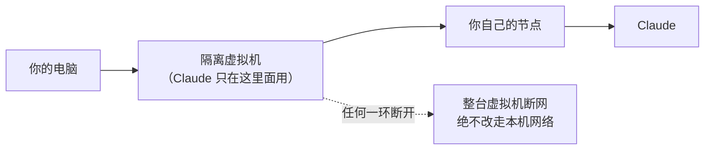

# cchouse

**一台干净、稳定、不漏网的 Claude 专用环境。**
在你的电脑里开一台隔离的小虚拟机，网页版 Claude 和 Claude Code 都在里面用，所有流量只走你自己的节点；节点一断，整台机器就断网，不会偷偷用你本机的网络。

[](https://github.com/nana-fox/cchouse/actions/workflows/ci.yml)
[](https://github.com/nana-fox/cchouse/releases)
[](LICENSE)

中文 | [English](README.en.md)


---

## 适合谁

你已经有一个自己的代理节点，想长期稳定地用 Claude（网页版 + Claude Code），又不想每天担心下面这些事：

1. **IP 飘来飘去**：今天一个地区，明天另一个地区。
2. **环境对不上**：IP 在美国，电脑时区却是北京时间、系统语言是中文。
3. **代理断了偷偷直连**：节点掉线的那几秒，软件悄悄用回了本机网络，真实 IP 就露了。

cchouse 的做法：只走你配置的那一个节点，把虚拟机的时区、语言、地区设成和节点所在地一致，并且断了就是断了，不会自动换路。

---

## 原理



- 虚拟机里只允许通往你那一个节点的流量，别的路一律堵死。
- 你的电脑本身照常上网，不受影响。

---

## 快速开始

本文对应镜像 `v2.0.0-preview.2`。安装器按仓库内的镜像清单下载并校验文件。[镜像大小与 SHA-256](guest-linux/image-manifest.json)

**第 1 步：装好基础软件和虚拟机软件**（一次性）

- 在 **Apple Silicon Mac** 上先装 [Homebrew](https://brew.sh)、Git 和 Python 3，再运行 `brew install cirruslabs/cli/tart`。
- 在 **Windows（x64）** 上先装 [Git for Windows](https://git-scm.com/download/win)、Python 3（在 PowerShell 里用 `py -3` 运行）、OpenSSH 客户端（Windows 设置 → 可选功能），并确认 BIOS 里已开启 CPU 虚拟化。再安装 VMware Workstation Pro（下载需要 Broadcom 账号），安装器会用到它的 `vmrun.exe` 和 `ovftool.exe`。

**第 2 步：运行安装器，粘贴单节点链接**

```bash
git clone https://github.com/nana-fox/cchouse.git
cd cchouse
python3 -I scripts/cchouse.py up --tag cc01
```

Windows PowerShell 用 `py -3 -I scripts/cchouse.py up --tag cc01`。

提示时粘贴节点链接，输入不会回显。安装器在后台通过宿主网络下载并校验镜像和官方 Claude Code 包，同时完成配置和自检。Apple Silicon Mac 和 Windows 会自动创建客机（导入镜像或克隆已有黄金镜像）、离线注入配置、清理明文配置文件、联网重启、运行 `verify-linux.sh --fail-closed` 并在通过后保存干净快照。[手动安装](docs/manual-install.md)

安装失败会停在出错的步骤。处理提示的原因后，从同一个目录重跑原命令，保留相同的 `--tag` 和自定义目录参数。安装器会续用已保存的步骤和校验过的下载文件。

**第 3 步：打开虚拟机桌面，网络检查全部通过后再登录**

自动验收通过后，打开虚拟机桌面上的网络检查页（就是上面那张图）。网络检查全部通过后，再在**虚拟机里的浏览器**登录 Claude。这一页只检查网络，不代表账号状态。

> 登录 Claude Code 时弹出的授权链接，也只能在虚拟机里的浏览器打开，不要复制到你本机的浏览器。

想手动控制每一步，或者让 AI Agent 代你装：见 [docs/manual-install.md](docs/manual-install.md)。

---

## 支持的电脑

| 你的电脑 | 用什么虚拟机软件 | 状态 |
|---|---|---|
| Apple Silicon Mac（M 系列） | Tart | ✅ `preview.2` 候选镜像通过 Mac mini 整机验收 |
| Windows（x64） | VMware Workstation Pro | ✅ 已有真机验证，`preview.2` 首装计时待测 |
| Intel Mac | — | 暂不支持 |

虚拟机里统一是 Debian 13 + Chromium + Claude Code。不支持 Linux 电脑作为宿主机。

**空缓存首次安装耗时**（包括镜像和 Claude Code 下载）

- **Apple Silicon Mac** 约 3–5 分钟到自动验收结束。Mac mini 的 `preview.1` 空缓存样本为 3 分 43 秒，镜像约 757 MB，经宿主代理平均约 7 MiB/s。该样本的旧镜像缺少关机授权，安装停在自动验收，未保存快照。
- **Windows** 的耗时为 `<COLD_WIN>`（待实测）。

---

## 你需要准备什么

- **一个节点**（cchouse 不提供节点）。支持 SOCKS5、HTTP(S)、VLESS、Trojan、Shadowsocks；不支持 Hysteria2、TUIC、WireGuard 这类走 UDP 的协议。最好是固定 IP、地区稳定的节点。
- **电脑配置**：建议内存 16 GB 以上，硬盘剩余 25 GB 以上。

> **关于 Stripe**：有些节点会拦截付款服务 Stripe。这只影响在 claude.ai 网页上付款，不影响登录和日常使用；安装时会提示你，但不会拦着你装。这只检查能否连通，不代表付款一定成功。需要的话可以加一个付款专用节点，见 [docs/proxy-modes.md](docs/proxy-modes.md)。

想用"前置节点 → 固定出口"的两跳链式代理？见 [docs/proxy-modes.md](docs/proxy-modes.md)（进阶）。

---

## 常见问题

<details>
<summary><b>用了会不会被封号？</b></summary>

**不保证。** 账号是否安全取决于很多我们控制不了的因素。

我们做了：只走你配置的那一个节点；时区、语言、地区和出口 IP 保持一致；节点断了就断网，不会漏出真实 IP；网页版和 Claude Code 都在同一台虚拟机里，只用官方网页和官方 Claude Code。

我们没做：不提供节点；不伪造浏览器指纹；不替你注册、登录或付款；不承诺任何账号结果。

</details>

<details>
<summary><b>为什么用虚拟机，不用指纹浏览器或直接开代理？</b></summary>

- **直接开代理**：代理软件一断，很多程序会自动回到本机网络；命令行工具也常常不走系统代理。电脑的时区、语言也还是你本地的。
- **指纹浏览器**：只管浏览器，管不到 Claude Code 这种命令行工具。
- **虚拟机**：整台机器的网络在系统层面锁死，只能走你的节点，网页和命令行走的是同一个出口，环境也一起配好。

</details>

<details>
<summary><b>Stripe 不通，能付款吗？</b></summary>

Stripe 不通只影响在 claude.ai 网页上付款。已经订阅的、或在别处付款的，不受影响。安装时只提示，不拦截。这只检查能否连通，不代表付款一定成功。要在虚拟机里付款，可以加一个付款专用节点，见 [docs/proxy-modes.md](docs/proxy-modes.md)。

</details>

<details>
<summary><b>国内下载很慢怎么办？</b></summary>

安装器下载会沿用宿主网络的代理设置。下载慢时可用 `--image-mirror <镜像目录 URL>` 指定镜像源，下载后仍会核对清单中的 SHA-256。也可在宿主先下载镜像，再按 [手动安装](docs/manual-install.md) 离线导入。

</details>

<details>
<summary><b>装的时候出错了怎么办？</b></summary>

用安装时生成的 `instance.env` 导出脱敏诊断包。已启动的客机可加 `--vm-ssh`，让工具尝试采集客机诊断信息。以下命令使用默认目录和标签 `cc01`。

```bash
python3 -I scripts/doctor.py --env "$HOME/Library/Application Support/cchouse/cc01/instance.env"
```

```powershell
py -3 -I scripts/doctor.py --env "$env:LOCALAPPDATA\cchouse\cc01\instance.env"
```

如果安装还未生成 `instance.env`，可省略 `--env` 参数，先采集宿主诊断。

**发公开 Issue 前请先解压检查**，确认没有残留的凭据或个人信息，再附到 [Issue](https://github.com/nana-fox/cchouse/issues) 里。详见 [docs/operations.md](docs/operations.md)。

</details>

<details>
<summary><b>VMware 为什么要注册 Broadcom 账号？</b></summary>

VMware 现在个人免费使用，但官方要求先在 Broadcom 官网注册账号才能下载，这一步目前绕不开。我们在评估不需要注册的替代方案。Apple Silicon Mac 用的 Tart 不需要注册。

</details>

---

## 安全设计

给想了解细节的人：

1. **一号、一机、一出口**：一台环境只登一个账号，只走你配置的那一个节点。
2. **出问题就断网**：代理挂了、配置写错，结果只能是断网，绝不退回本机直连。客机防火墙默认全断，只放行代理进程访问你节点的那一个地址；代理配置里不允许出现直连规则，脚本会硬拦截；UDP 和 IPv6 一律封锁。
3. **环境和出口一致**：时区、语言、地区、键盘都按出口所在地配置，自动验收会核对出口 IP 的时区和虚拟机时区是否一致。
4. **全在虚拟机里闭环**：只用官方网页和官方 Claude Code；登录授权链接只在虚拟机浏览器里打开。
5. **凭据不落仓库**：节点信息只存在你电脑上的私有目录（仅本人可读），明文中间文件用完即删；仓库自带提交钩子拦截疑似凭据。

我们**绝不**做：内置节点、为了"恢复联网"放宽断网保护、桌面 GUI 程序。

架构细节见 [docs/architecture.md](docs/architecture.md)，验收项见 [docs/verify.md](docs/verify.md)。

---

## 免责声明

cchouse 只是一个本地环境配置工具，**不保证账号安全**，也不提供任何代理服务。请自行遵守你所在地的法律法规，以及 Anthropic 和你所用服务的使用条款。

## License · 贡献 · 更新日志

- License：[MIT](LICENSE)
- 贡献：欢迎提 Issue 和 PR。改了模板或脚本，请跑 `python3 -I -m unittest discover -s tests` 并在 [CHANGELOG.md](CHANGELOG.md) 记一笔；开发规则见 [AGENTS.md](AGENTS.md)。
- 更新日志：[CHANGELOG.md](CHANGELOG.md)
