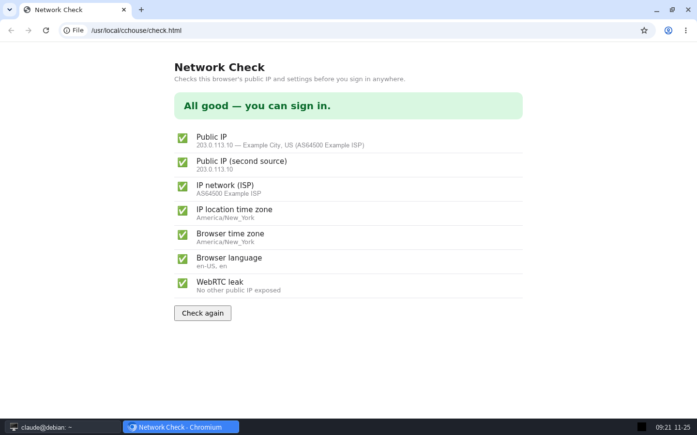
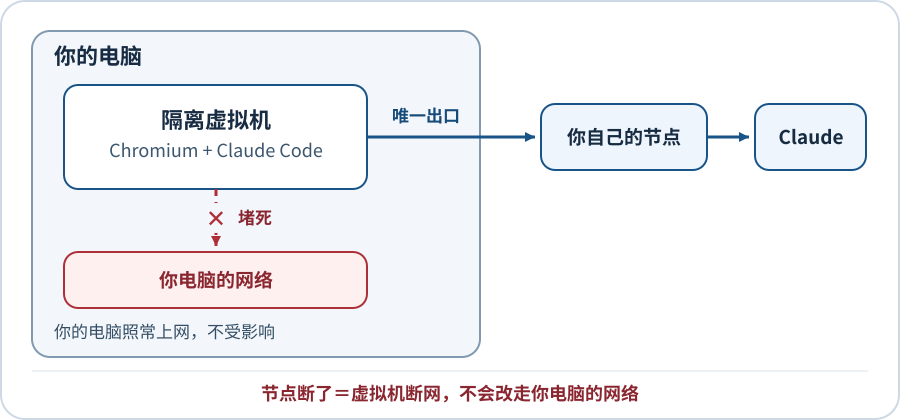

# cchouse

**一台干净、稳定、不漏网的 Claude 专用环境。**
在你的电脑里开一台隔离的小虚拟机，网页版 Claude 和 Claude Code 都在里面用，所有流量只走你自己的节点；节点一断，整台机器就断网，不会偷偷用你本机的网络。

[](https://github.com/nana-fox/cchouse/actions/workflows/ci.yml)
[](https://github.com/nana-fox/cchouse/releases)
[](LICENSE)

中文 | [English](README.en.md)



---

## 适合谁

你已经有一个自己的代理节点，想长期稳定地用 Claude（网页版 + Claude Code），又不想每天担心下面这些事：

1. **IP 飘来飘去**：今天一个地区，明天另一个地区。
2. **环境对不上**：IP 在美国，电脑时区却是北京时间、系统语言是中文。
3. **代理断了偷偷直连**：节点掉线的那几秒，软件悄悄用回了本机网络，真实 IP 就露了。

cchouse 的做法：只走你配置的那一个节点，把虚拟机的时区、语言、地区设成和节点所在地一致，并且断了就是断了，不会自动换路。

---

## 原理



- 虚拟机里只允许通往你那一个节点的流量，别的路一律堵死。
- 你的电脑本身照常上网，不受影响。

---

## 快速开始

安装器会下载并校验匹配的客机镜像和官方 Claude Code 包。[镜像清单](guest-linux/image-manifest.json)

### Windows（x64）

打开 Windows PowerShell，运行下面这一行安装 `v2.0.0-preview.5`。

```powershell
$f = "$env:TEMP\cchouse-bootstrap-$([guid]::NewGuid().ToString('N')).ps1"; iwr https://github.com/nana-fox/cchouse/releases/download/v2.0.0-preview.5/bootstrap-windows.ps1 -UseBasicParsing -OutFile $f -ErrorAction Stop; if ((Get-FileHash $f -Algorithm SHA256).Hash -ne '060aa41e0c8a042552e825cb46a66cfa21552a21701101c9ac4bb9832b2fd51e') { throw 'SHA-256 mismatch' }; Unblock-File -LiteralPath $f; powershell -NoProfile -ExecutionPolicy RemoteSigned -File $f -CleanupBootstrap
```

按提示粘贴自己的节点链接，输入不会回显。缺少 VirtualBox 时，安装器会自动安装。Windows 弹出用户账户控制（UAC）提示时，点一次「是」。

### Apple Silicon Mac

需要 Apple Silicon（M 系列）及 macOS 13.0 Ventura 或更新版本。打开「终端」，运行下面这一行安装 `v2.0.0-preview.5`。引导脚本会校验并准备私有 Python 和所需的 Tart。

```bash
f=$(mktemp -t cchouse-bootstrap) && curl -fsSLo "$f" https://github.com/nana-fox/cchouse/releases/download/v2.0.0-preview.5/bootstrap-macos.sh && printf '%s  %s\n' '43d7386e95787919d9fdc1a9b72f6503d08e80ee244ee1d98bf6ac5cd713de78' "$f" | shasum -a 256 -c - && /bin/bash "$f" --cleanup-bootstrap
```

按提示粘贴自己的 SOCKS5 或 HTTP(S) 节点链接，输入不会回显。

### 打开客机并登录

安装器会配置客机、运行自动验收，并在通过后保存干净快照。遇到错误时，按提示处理后重跑同一条命令。安装器会复用已校验的下载和已完成的步骤。

自动验收通过后，打开虚拟机桌面上的网络检查页（就是上面那张图）。网络检查全部通过后，再在**虚拟机里的浏览器**登录 Claude。这一页只检查网络，不代表账号状态。

> 登录 Claude Code 时弹出的授权链接，也只能在虚拟机里的浏览器打开，不要复制到你本机的浏览器。

### 日常使用

装完后桌面上有 `cchouse (cc01)` 图标。

- **打开**：双击桌面图标。已经开着时不会再开一台。
- **关机**：在虚拟机桌面右键选 **Power Off (Safe Shutdown)**。Windows 直接点窗口关闭按钮也是正常关机；**Mac 点 Tart 窗口关闭按钮等于断电**，未保存的内容会丢。
- **回到刚装好的样子**：运行 `cchouse restore --tag cc01`。节点配置保留，虚拟机里的文件和登录状态清空。
- **查看状态 / 命令关机**：`cchouse status --tag cc01`、`cchouse stop --tag cc01`。
- 终端找不到 `cchouse` 时：Mac 用 `~/.local/bin/cchouse`，Windows 用 `%LOCALAPPDATA%\cchouse\bin\cchouse.cmd`。

让 AI Agent 协助安装见 [AGENTS.md](AGENTS.md)。手动配置见 [进阶安装](docs/manual-install.md)。

---

## 支持的电脑

| 你的电脑 | 用什么虚拟机软件 | 状态 |
|---|---|---|
| Apple Silicon Mac（M 系列） | Tart | ✅ `v2.0.0-preview.4` 已完成公开命令盲装与真机冷下载验收（26 PASS / 0 FAIL / 1 Stripe WARN） |
| Windows（x64） | VirtualBox | ✅ `v2.0.0-preview.4` 已在 Windows 11 实机完成空缓存公开命令盲装（26 PASS / 0 FAIL / 1 Stripe WARN） |
| Intel Mac | — | 暂不支持 |

虚拟机里统一是 Debian 13 + Chromium + Claude Code。不支持 Linux 电脑作为宿主机。

**空缓存首次安装耗时**（总耗时主要取决于网络下载速度）

首次安装除下载客机镜像和官方 Claude Code 包外，引导阶段还会下载源码包与私有 Python（Mac 未装 Tart 时会下载私有 Tart，Windows 未装 VirtualBox 时会自动下载并安装 VirtualBox）。可按文件大小估算下载时间：

- **客机镜像**：Apple Silicon Mac（`.tvm`）约 **874 MiB**（`915,980,115` 字节），Windows x64（`.ova`）约 **1511 MiB**（`1,584,588,800` 字节，约 1.5 GB）。
- **官方 Claude Code 包**：约 **175 MiB**（`183,973,219` 字节）。

`v2.0.0-preview.4` 公开命令与真机实测参考（进度持续更新时可继续等待）：

- **Windows 11（x64）**：空缓存公开命令盲装通过（26 PASS / 0 FAIL / 1 Stripe WARN），安装器合计 **48 分 09 秒**；其中客机镜像下载耗时 **45 分 38 秒**（平均 0.37 MB/s，受当时网速影响；Claude Code 16 分 49 秒、VirtualBox 16 分 10 秒与安装步骤重叠）。
- **Apple Silicon Mac**：公开命令盲装通过（26 PASS / 0 FAIL / 1 Stripe WARN）；该轮镜像与 Claude Code 命中预热缓存，引导阶段下载源码包、私有 Python 和私有 Tart 用时约 **7 分 33 秒**，`cchouse up` 用时 **1 分 57 秒**，全程 **9 分 30 秒**。另在 `v2.0.0-preview.4` 真机冷下载验收中（经宿主代理），TVM 镜像用时 **51.8 秒**（16.85 MiB/s），Claude Code 用时 **15.3 秒**（11.47 MiB/s），除等待输入节点外核心安装与验收用时 **88.5 秒**（同样 26 PASS / 0 FAIL / 1 Stripe WARN）。

---

## 你需要准备什么

- **一个 SOCKS5 或 HTTP(S) 节点**。请自备固定 IP、地区稳定的节点。VLESS、Trojan、Shadowsocks 和两跳代理见 [进阶出口配置](docs/proxy-modes.md)。
- **电脑配置**：建议内存 16 GB。含所需下载，Windows 安装卷至少剩余 **7 GB**（建议 **10 GB**），Apple Silicon 至少 **9 GB**（建议 **12 GB**）。

> **关于 Stripe**：有些节点会拦截付款服务 Stripe。这只影响在 claude.ai 网页上付款，不影响登录和日常使用；安装时会提示你，但不会拦着你装。这只检查能否连通，不代表付款一定成功。需要的话可以加一个付款专用节点，见 [docs/proxy-modes.md](docs/proxy-modes.md)。

---

## 常见问题

<details>
<summary><b>用了会不会被封号？</b></summary>

**不保证。** 账号是否安全取决于很多我们控制不了的因素。

我们做了：只走你配置的那一个节点；时区、语言、地区和出口 IP 保持一致；节点断了就断网，不会漏出真实 IP；网页版和 Claude Code 都在同一台虚拟机里，只用官方网页和官方 Claude Code。

我们没做：不提供节点；不伪造浏览器指纹；不替你注册、登录或付款；不承诺任何账号结果。

</details>

<details>
<summary><b>为什么用虚拟机，不用指纹浏览器或直接开代理？</b></summary>

- **直接开代理**：代理软件一断，很多程序会自动回到本机网络；命令行工具也常常不走系统代理。电脑的时区、语言也还是你本地的。
- **指纹浏览器**：只管浏览器，管不到 Claude Code 这种命令行工具。
- **虚拟机**：整台机器的网络在系统层面锁死，只能走你的节点，网页和命令行走的是同一个出口，环境也一起配好。

</details>

<details>
<summary><b>Stripe 不通，能付款吗？</b></summary>

Stripe 不通只影响在 claude.ai 网页上付款。已经订阅的、或在别处付款的，不受影响。安装时只提示，不拦截。这只检查能否连通，不代表付款一定成功。要在虚拟机里付款，可以加一个付款专用节点，见 [docs/proxy-modes.md](docs/proxy-modes.md)。

</details>

<details>
<summary><b>国内下载很慢怎么办？</b></summary>

下载分为两个阶段，均沿用宿主网络的代理设置（如系统代理或终端代理环境变量）：

1. **引导阶段下载**（从 GitHub / Python 官方源拉取源码 zip、私有 Python，以及 Mac 缺少 Tart 时的私有 Tart）：此阶段显示进度，断流会自动重试并断点续传；`--image-mirror` **不作用于**引导阶段的这些下载。
2. **镜像与组件下载**（进入 `cchouse up` 后下载客机镜像、官方 Claude Code 包，以及 Windows 缺少 VirtualBox 时的 VirtualBox 安装包）：下载后均会核对清单中的 SHA-256。

**给客机镜像指定镜像源**：在首页一键命令末尾追加参数即可（下载后仍按清单校验 SHA-256）：

- **Apple Silicon Mac**：在 Mac 命令末尾 `--cleanup-bootstrap` 后追加 ` --image-mirror '<镜像目录 URL>'`。
- **Windows（x64）**：在 Windows 命令末尾 `-CleanupBootstrap` 后追加 ` -ImageMirror '<镜像目录 URL>'`。

也可以先设置环境变量 `CCHOUSE_IMAGE_MIRROR` 再原样运行首页命令。

若直接使用 `scripts/cchouse.py up`（见 [手动安装](docs/manual-install.md)），可直接传入 `--image-mirror <镜像目录 URL>`；也可在宿主先下载镜像再离线导入。

**下载中断如何续跑**：无论是引导阶段还是镜像下载中途断流或失败，直接**原样重跑快速开始中的同一条命令**即可续跑。已通过 SHA-256 校验的下载和已完成的步骤都会自动复用。

</details>

<details>
<summary><b>电脑开着 Clash 的 TUN 模式，首次验收出口连测失败？</b></summary>

等 1–2 分钟，再重跑快速开始里的同一条安装命令。安装器会续跑并重新验收。如果客机已经关机，先在虚拟机软件中启动同一台客机。

如果仍失败，请检查节点连通性，并按下一节导出诊断包。

</details>

<details>
<summary><b>装的时候出错了怎么办？</b></summary>

用引导脚本准备的 Python 和源码导出脱敏诊断包。见 [Mac](docs/operations.md#mac-一键安装后的诊断与卸载) 与 [Windows](docs/operations.md#windows-一键安装后的诊断与卸载) 操作说明。

**发公开 Issue 前请先解压检查**，确认没有残留的凭据或个人信息，再附到 [Issue](https://github.com/nana-fox/cchouse/issues) 里。详见 [docs/operations.md](docs/operations.md)。

</details>

---

## 卸载

运行 `cchouse remove --tag cc01`，桌面图标会一并删除。详细说明见 [Mac](docs/operations.md#mac-一键安装后的诊断与卸载) 或 [Windows](docs/operations.md#windows-一键安装后的诊断与卸载)。请使用安装时的标签。指定过 `--private-dir` 时也传入原路径。

安装器会先列出它能确认归属的虚拟机、干净快照、私有目录和临时明文，再询问是否删除。回车默认取消，`--yes` 会跳过确认。在 VirtualBox 中，卸载会先关机，再用 `VBoxManage unregistervm --delete` 删除安装记录里名字精确匹配的那一台。旧安装缺少能验证归属的记录时，请在虚拟机软件中核对后，按提示手动清理。

黄金镜像和下载缓存默认保留，供其他实例复用。确认无需复用时，可加 `--purge-cache`，清单会列出对应 Tart 黄金镜像和可识别的下载缓存及大小。结束时会显示剩余内容和手动清理方法。

## 安全设计

给想了解细节的人：

1. **一号、一机、一出口**：一台环境只登一个账号，只走你配置的那一个节点。
2. **出问题就断网**：代理挂了、配置写错，结果只能是断网，绝不退回本机直连。客机防火墙默认全断，只放行代理进程访问你节点的那一个地址；代理配置里不允许出现直连规则，脚本会硬拦截；UDP 和 IPv6 一律封锁。
3. **环境和出口一致**：时区、语言、地区、键盘都按出口所在地配置，自动验收会核对出口 IP 的时区和虚拟机时区是否一致。
4. **全在虚拟机里闭环**：只用官方网页和官方 Claude Code；登录授权链接只在虚拟机浏览器里打开。
5. **凭据不落仓库**：节点信息只存在你电脑上的私有目录（仅本人可读），明文中间文件用完即删；仓库自带提交钩子拦截疑似凭据。

我们**绝不**做：内置节点、为了"恢复联网"放宽断网保护、独立的桌面客户端或控制面板（桌面图标只是调用 `cchouse open` 的系统快捷方式）。

架构细节见 [docs/architecture.md](docs/architecture.md)，验收项见 [docs/verify.md](docs/verify.md)。

---

## 免责声明

cchouse 只是一个本地环境配置工具，**不保证账号安全**，也不提供任何代理服务。请自行遵守你所在地的法律法规，以及 Anthropic 和你所用服务的使用条款。

## License · 贡献 · 更新日志

- License：[MIT](LICENSE)
- 贡献：欢迎提 Issue 和 PR。改了模板或脚本，请跑 `python3 -I -m unittest discover -s tests` 并在 [CHANGELOG.md](CHANGELOG.md) 记一笔；开发规则见 [AGENTS.md](AGENTS.md)。
- 更新日志：[CHANGELOG.md](CHANGELOG.md)
